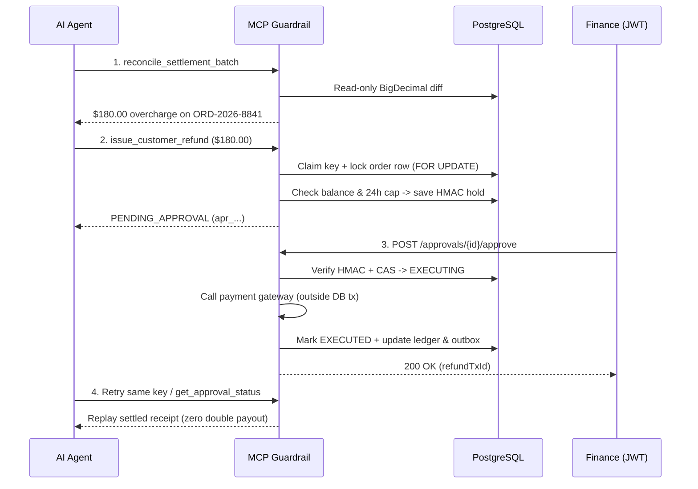
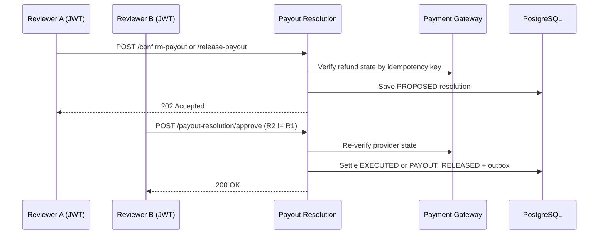

# spring-mcp-settlement-guard

[](https://github.com/yfggg/spring-mcp-settlement-guard/actions/workflows/ci.yml)
[](#quick-start)
[](https://docs.spring.io/spring-ai/reference/api/mcp/mcp-server-boot-starter-docs.html)
[](#license)

**Server-side Spring Boot & Spring AI MCP guardrail for money movement: deterministic `BigDecimal` reconciliation, row-locked velocity caps, idempotent Stripe refunds, HMAC-signed approval holds, and four-eyes payout reconciliation.**

AI agent prototypes fail the moment they touch real money or production ledgers: tool retries cause double payouts, LLMs miscalculate currency math, prompt-injected callers split claims ("smurfing") under per-call limits, and high-value writes run without an authenticated human checkpoint.

This repository keeps arithmetic, velocity limits, and approval state inside your Java backend instead of trusting the chat client.

## How It Works



<details>
<summary>Gateway timeout path: four-eyes <code>PAYOUT_UNKNOWN</code> resolution</summary>

When a downstream gateway call times out after `EXECUTING` commits, the request freezes as `PAYOUT_UNKNOWN` (continuing to reserve balance and blocking re-approval) until two distinct finance reviewers reconcile it against the provider:



</details>

## Quick Start

Requires JDK 17+ (or 21). Runs out of the box on embedded H2 with four seeded sample invoices, against live **Stripe Test Mode**, or on **PostgreSQL 16**:

```bash
# 1a. Default offline demo on H2 (MCP SSE at http://localhost:8080/sse)
./mvnw spring-boot:run

# 1b. Live Stripe Test Mode (seeds 4 test PaymentIntents and issues real sandbox refunds)
STRIPE_SECRET_KEY=sk_test_... ./mvnw spring-boot:run -Dspring-boot.run.profiles=stripe

# 1c. PostgreSQL 16 (disables demo seed and /api/demo; requires custom secrets)
docker compose up -d
MCP_AGENT_API_KEY=replace-me \
MCP_REVIEWER_JWT_SECRET=replace-with-at-least-32-random-bytes \
MCP_SNAPSHOT_HMAC_KEY=replace-me \
  ./mvnw spring-boot:run -Dspring-boot.run.profiles=postgres
```

Connect from Cursor (`~/.cursor/mcp.json`) or any MCP SSE client:

```json
{
  "mcpServers": {
    "settlement-guard": {
      "url": "http://localhost:8080/sse",
      "headers": { "X-MCP-API-Key": "mcp-demo-agent-key-2026" }
    }
  }
}
```

Or exercise the two-phase approval loop via `curl`:

```bash
# Propose a $180.00 refund (> $50.00 auto-approve limit -> 202 PENDING_APPROVAL)
curl -X POST http://localhost:8080/api/demo/simulate-agent-refund \
  -H "Content-Type: application/json" \
  -H "X-MCP-API-Key: mcp-demo-agent-key-2026" \
  -d '{"orderId":"ORD-2026-8841","amount":"180.00","currency":"USD","reasonCode":"DUPLICATE_CHARGE","idempotencyKey":"idem-8841-01"}'

# Mint an HS256 finance reviewer JWT and approve the frozen snapshot
TOKEN=$(java tools/MintReviewerToken.java finance-lead@company.com)
curl -X POST http://localhost:8080/api/approvals/apr_.../approve -H "Authorization: Bearer $TOKEN"
```

Run the full verification suite (50+ offline concurrency, fault-injection, and MCP wire tests; zero LLM API keys required):

```bash
./mvnw clean verify
```

## MCP Tools & Core Guarantees

| MCP Tool | Access | Purpose |
| :--- | :--- | :--- |
| `reconcile_settlement_batch` | Read-only | Compares invoice expected vs. gateway captured amounts in exact `BigDecimal` (`HALF_UP`), returning per-order variances. |
| `issue_customer_refund` | Mutating | Validates arguments, claims an idempotency slot, checks order balance and 24h velocity under `SELECT ... FOR UPDATE`, and either settles `<= $50` or holds as `PENDING_APPROVAL`. |
| `get_approval_status` | Read-only | Returns current approval status and settled `refundTxId` without exposing internal thresholds or reviewer identities. |

| Failure Mode | Server-Side Guardrail |
| :--- | :--- |
| **Duplicate retries & key swaps** | 3-state relational `IdempotencyKeyStore` (`IN_PROGRESS` / `COMPLETED` / `UNKNOWN_SUSPENDED`). Omitted keys fall back to a SHA-256 request fingerprint; new keys sent while an identical refund is in flight link to the existing request. |
| **Gateway timeouts mid-payout** | Allowance commits as `EXECUTING` *before* calling the gateway outside any DB transaction. Timeouts freeze as `PAYOUT_UNKNOWN` so a rollback never re-opens a claimed payout. |
| **Single-actor resolution risk** | `PAYOUT_UNKNOWN` requires two distinct reviewers (`CONFIRM` or `RELEASE`), verified twice against the payment provider's refund lookup and enforced by a unique `transaction_id` constraint. |
| **Smurfing & over-refunds** | Per-order `SELECT ... FOR UPDATE` lock checks `amount <= captured - refunded - reserved` and sums `EXECUTED`, `EXECUTING`, `PAYOUT_UNKNOWN`, and `PENDING_APPROVAL` across a rolling 24h window (`<= $200`). |
| **Prompt injection & probing** | Bean Validation rejects malformed inputs before any DB write; paused responses return opaque hold messages without leaking thresholds or remaining allowances. |
| **Payload tampering & self-approval** | Paused refunds store a server-keyed `HMAC-SHA256` snapshot; `/approve` accepts no amount body and requires a signed `FINANCE_APPROVER` JWT separate from `X-MCP-API-Key`. |
| **Mid-flight crashes & schema drift** | `StaleExecutionSweeper` freezes stuck in-flight rows and redelivers unpublished outbox events by `eventId`; Flyway (`V1`–`V5`) owns the schema with Hibernate `ddl-auto: validate`. |

## Where This Fits

**Reference scenario — e-commerce & SaaS post-sale refunds:** Operations agents run `reconcile_settlement_batch` to catch duplicate captures or shipping overcharges, while support agents settle routine micro-refunds (`<= $50`) automatically and route larger or split claims to finance.

**Why server-side holds instead of client-side MCP prompts:** Desktop MCP hosts can ask *"Allow this tool call?"*, which only gates whether a request leaves the chat UI. The person chatting is rarely an authorized finance approver, hosts can auto-approve, and real reviews happen hours later in Slack or an internal back office. Reserving balance on the server and requiring a backend JWT keeps money control independent of the host UI.

**Beyond customer refunds:** Swapping `PaymentGatewayPort` (`DeterministicPaymentGateway` offline, `StripePaymentGateway` live) adapts the same guardrail to **accounts payable & contractor payouts**, **wallet or goodwill credit issuance**, and **privileged billing or credit-limit changes**.

<details>
<summary>Production Deployment &amp; Operations Notes</summary>

- **Reviewer identity (IdP):** Replace the demo HS256 `reviewerJwtDecoder` bean in `McpSecurityConfig` with `JwtDecoders.fromIssuerLocation(...)` and map your provider's role claim to `FINANCE_APPROVER`.
- **Resolving `PAYOUT_UNKNOWN` (four-eyes CLI):**
  ```bash
  TOKEN_A=$(java tools/MintReviewerToken.java finance-lead@company.com)
  TOKEN_B=$(java tools/MintReviewerToken.java controller@company.com)

  # Confirm settled payout (provider lookup must match tx id, amount, and currency)
  curl -X POST http://localhost:8080/api/approvals/apr_.../confirm-payout \
    -H "Content-Type: application/json" -H "Authorization: Bearer $TOKEN_A" \
    -d '{"transactionId":"re_..."}'

  # Or release reservation (after provider cancel, or after settlement window when not found)
  curl -X POST http://localhost:8080/api/approvals/apr_.../release-payout -H "Authorization: Bearer $TOKEN_A"

  # Second reviewer applies the proposal
  curl -X POST http://localhost:8080/api/approvals/apr_.../payout-resolution/approve -H "Authorization: Bearer $TOKEN_B"
  ```
- **Custom payment adapters:** Forward `idempotencyRef` to the provider, implement `lookupRefund` (`SUCCEEDED`, `PENDING`, `FAILED`, `CANCELLED`, `NOT_FOUND`), and throw on network/provider outages so outages are never mistaken for `NOT_FOUND`.
- **Outbox, audit & multi-tenancy:** Webhook delivery is at-least-once (deduplicate by `eventId`; add ShedLock across multiple nodes). Audit writes run post-commit; route them through the outbox if strict audit completeness is required. Add per-agent rate limits and tenant-scoped approval lookup before multi-tenant exposure.

</details>

## Adapting This to Your Stack (Commercial Support)

Need to wire AI agents or MCP servers into your existing **Spring Boot, Java, or Python** production backend without risking duplicate writes, compliance gaps, or runaway token bills?

I help US/EU engineering teams ship production-safe agent workflows on **predictable fixed-price milestones** (async-first workflow with written specs, sequence diagrams, and recorded walkthroughs):

- **Architecture Audit & Sandboxed Pilot ($600 / 5 business days):** 1-page architecture spec + 2 read-only/sandboxed MCP tools over your APIs + offline CI test harness.
- **Production Two-Phase Approval Integration ($2,000–$3,500 / 2 weeks):** End-to-end MCP/LangGraph workflow, human-in-the-loop approval state machine, role-based security, and per-run token telemetry.

Reach out with a brief note on your stack: **fyang1989127@gmail.com**

## License

MIT
