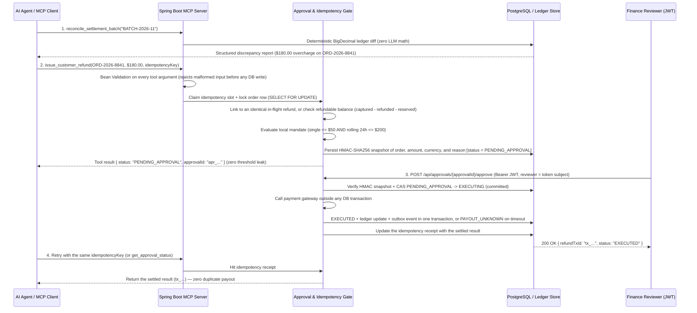
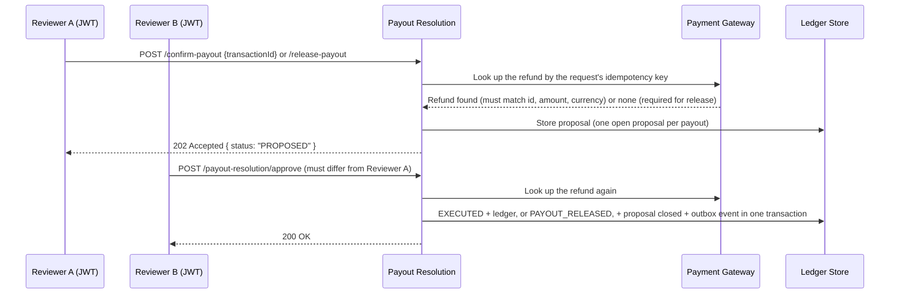

# spring-mcp-settlement-guard

[](https://github.com/yfggg/spring-mcp-settlement-guard/actions/workflows/ci.yml)
[](#quick-start-3-minutes)
[](https://docs.spring.io/spring-ai/reference/api/mcp/mcp-server-boot-starter-docs.html)
[](#license)

**Production-grade reference architecture for exposing financial & state-mutating Spring Boot APIs to AI Agents over MCP—with deterministic reconciliation, local-first hidden mandates, anti-smurfing velocity locks, idempotency gates, two-phase human-in-the-loop approval, and four-eyes payout reconciliation.**

Most AI agent prototypes look great in a notebook and fail the moment they touch real money or production databases:
1. **Tool retries trigger duplicate payouts or double writes.**
2. **LLMs hallucinate on arithmetic** that should stay in deterministic `BigDecimal` code.
3. **Adversarial or prompt-injected agents split claims ("smurfing") or probe remote mandates** to drain accounts just under per-call limits.
4. **High-impact mutations execute without a pause/resume human approval boundary.**
5. **CI pipelines either skip agent tests or burn API credits on flaky LLM calls.**

This repository demonstrates a clean, battle-tested pattern derived from high-concurrency clearing & settlement systems: **keep deterministic math and hidden mandates inside your local Java backend, serialize per-order velocity checks under row locks, and gate high-risk writes behind an HMAC-SHA256 approval checkpoint signed off by an authenticated reviewer.**

## How the Two-Phase Guardrail Works



When the gateway times out, the payout is frozen as `PAYOUT_UNKNOWN` and resolved by two different reviewers:



## Core Engineering Guarantees

| Failure Mode in Naive Agents | How `spring-mcp-settlement-guard` Solves It |
| :--- | :--- |
| **Duplicate mutations on timeout/retry** | Stripe-style 3-state `IdempotencyKeyStore` (`IN_PROGRESS` / `COMPLETED` / `UNKNOWN_SUSPENDED`) backed by a DB unique constraint in an isolated transaction before side effects run. The fingerprint covers every business field, so reusing a key with any changed field is a `409`. If the caller omits the key, the server uses that fingerprint as the one-time key, so the same order, amount, currency, and reason cannot pay twice. If an agent retries under a *new* key while an identical refund (same order, amount, currency, reason) is still pending, executing, or frozen, the request is linked to the existing one instead of reserving and paying again; the link is stored with the evaluation, so it survives crashes. Once money has moved, the caller always gets the settled result, even if storing the receipt fails. |
| **Gateway timeout after money may have moved** | The payout is reserved as `EXECUTING` and committed *before* the gateway call, which runs outside any DB transaction. A timeout freezes the request as `PAYOUT_UNKNOWN`: it keeps counting against limits and cannot be approved again. |
| **One person (or one stolen key) closing a frozen payout** | Resolving `PAYOUT_UNKNOWN` takes two reviewers: one proposes CONFIRM or RELEASE, a different one approves. Both steps look the refund up at the gateway by its idempotency key: CONFIRM needs a matching transaction id, amount, and currency; RELEASE needs the gateway to have no refund. A provider transaction id can settle only one refund (unique constraint). |
| **Refunds for unknown orders or over-refunds** | Under the order row lock, the request is rejected unless the order exists and `amount <= captured - already refunded - reserved (pending / executing / unknown)`. Unknown order ids leave no rows behind. |
| **Split-claim ("smurfing") & race attacks** | `ApprovalGateService` acquires a `SELECT ... FOR UPDATE` per-order lock and sums `EXECUTED`, `EXECUTING`, `PAYOUT_UNKNOWN` and in-flight `PENDING_APPROVAL` amounts across a rolling 24h window (`<= $200.00` default). |
| **Malformed or injected tool arguments** | Every MCP tool parameter carries Bean Validation constraints (`@Digits`, `@Pattern`, `@Size`); invalid input is rejected before an idempotency slot is claimed or a row lock is taken. |
| **Mandate probing & prompt injection** | Mandates remain 100% local in Spring configuration; MCP tools return opaque hold messages without leaking internal thresholds, remaining allowances, or reviewer identities. |
| **Payload swapping before sign-off** | Paused actions store an HMAC-SHA256 of order id, amount, currency, and reason, keyed by a server secret. `/api/approvals/{id}/approve` accepts zero amount inputs, re-verifies the MAC, and claims execution via atomic CAS. Rewriting the amount and the stored digest together still fails. |
| **Conflicting reviewer decisions** | Approve and reject are both CAS transitions from `PENDING_APPROVAL`. The loser gets a `409`, so a rejection webhook is never sent for a refund that was actually paid. |
| **Forged reviewer identity & self-approval** | Agents authenticate with `X-MCP-API-Key` and get only `ROLE_MCP_AGENT`. Reviewers present a signed JWT; the issuer, expiry, and subject are required, the reviewer identity is the token subject, and `ROLE_FINANCE_APPROVER` comes only from the token's `roles` claim. An agent key cannot be combined with a reviewer token. |
| **Crashes mid-flight** | `StaleExecutionSweeper` freezes idempotency keys stuck in `IN_PROGRESS` and payouts stuck in `EXECUTING` (default 15 min). A key frozen before any reservation is released on retry. Approval events are written to an outbox in the same transaction as the status change and carry a stable `eventId`; the sweeper redelivers rows still unpublished after a grace period. |
| **Schema drift** | Flyway owns the schema (`db/migration`); Hibernate runs with `ddl-auto: validate`. |
| **LLM arithmetic errors** | Ledger matching and currency rounding run strictly in read-only Java `BigDecimal` domain services (`DeterministicReconciler`). |
| **Expensive, flaky CI tests** | Full integration suite uses the official `McpSyncClient` over SSE + multi-threaded race harnesses + failure injection. JDK 17 and 21 run on H2; a separate job runs the same suite on PostgreSQL 16. No external LLM API keys. |

## Where This Fits (Use Cases & Beyond Refunds)

**Reference scenario modeled in this repository — e-commerce & SaaS post-sale refunds:**
- **Batch settlement reconciliation (`reconcile_settlement_batch`):** Operations or finance agents compare expected invoice totals against gateway-captured amounts (duplicate captures, shipping overcharges, fee variances) in read-only `BigDecimal` code instead of letting an LLM do arithmetic in context.
- **Tiered customer support refunds (`issue_customer_refund`):** Support agents settle routine micro-refunds automatically within remaining order balance and velocity caps (`<= $50.00` single, `<= $200.00` rolling 24h), while larger or split claims freeze as `PENDING_APPROVAL` for a finance reviewer—and gateway timeouts freeze as `PAYOUT_UNKNOWN` for two-reviewer reconciliation.

**Why server-side holds instead of client-side MCP confirmation prompts:**
Desktop MCP hosts can ask a user *"Allow this tool call?"* before sending a request, which gates whether a tool runs in that chat session. Financial controls need a different boundary: the person chatting with the agent is rarely an authorized finance approver, client UIs can be set to auto-approve, and real reviews happen minutes or hours later in Slack or an internal back office. Here the MCP tool reserves the allowance on the server, returns `PENDING_APPROVAL` immediately, and requires an authenticated backend sign-off before money moves.

**Adapting the guardrail to other state-mutating workflows:**
Swapping `PaymentGatewayPort` applies the same row-locked velocity check, idempotency store, HMAC snapshot, and outbox pattern to other high-risk agent actions:
- **Accounts payable & contractor payouts:** Matching vendor invoices or contractor timesheets before releasing bank transfers.
- **Wallet credits & promotional issuance:** Letting support agents issue small goodwill credits automatically while holding larger balance adjustments for review.
- **Privileged billing or account changes:** Gating credit-limit increases, plan overrides, or risk-hold releases proposed by internal ops agents.

## Project Layout

```text
spring-mcp-settlement-guard/
├── docker-compose.yml
├── pom.xml
├── tools/
│   └── MintReviewerToken.java          # JDK-only reviewer token generator for local testing
└── src/
    ├── main/java/io/mcpguard/settlement/
    │   ├── McpSettlementGuardApplication.java
    │   ├── config/
    │   │   ├── DemoDataInitializer.java
    │   │   ├── GuardrailConfigurationGuard.java
    │   │   ├── GuardrailProperties.java
    │   │   ├── McpSecurityConfig.java
    │   │   ├── StripeDemoChargeInitializer.java
    │   │   └── StripeProperties.java
    │   ├── domain/
    │   │   ├── DeterministicPaymentGateway.java
    │   │   ├── DeterministicReconciler.java
    │   │   ├── OrderAnchorLockService.java
    │   │   ├── OrderSettlementAnchor.java
    │   │   ├── PaymentGatewayPort.java
    │   │   ├── ProviderRefundLookup.java
    │   │   ├── SettlementInvoiceItem.java
    │   │   ├── SnapshotHasher.java
    │   │   └── StripePaymentGateway.java
    │   ├── guardrail/
    │   │   ├── ApprovalEventOutbox.java
    │   │   ├── ApprovalGateService.java
    │   │   ├── ApprovalRestController.java
    │   │   ├── ApprovalStatus.java
    │   │   ├── ApprovalWebhookNotifier.java
    │   │   ├── DemoRefundController.java
    │   │   ├── IdempotencyKeyStore.java
    │   │   ├── PayoutReconciliationJob.java
    │   │   ├── PayoutResolution.java
    │   │   ├── PayoutResolutionService.java
    │   │   ├── RefundApprovalOrder.java
    │   │   └── StaleExecutionSweeper.java
    │   ├── mcp/
    │   │   ├── McpServerToolsConfig.java
    │   │   ├── ReconciliationMcpTools.java
    │   │   └── RefundActionMcpTools.java
    │   └── telemetry/
    │       └── ToolExecutionAuditLog.java
    ├── main/resources/db/migration/
    │   ├── V1__baseline_schema.sql
    │   ├── V2__payout_release_and_ledger_guards.sql
    │   ├── V3__unique_transaction_id.sql
    │   ├── V4__four_eyes_resolution_and_event_ids.sql
    │   └── V5__payout_reconciliation_exception.sql
    └── test/java/io/mcpguard/settlement/
        ├── ApprovalLifecycleIT.java
        ├── GuardrailEdgeCaseIT.java
        ├── DemoEndpointDisabledIT.java
        ├── DeterministicMockAgentTest.java
        ├── ReviewerTokens.java
        ├── StripeLiveSandboxIT.java
        ├── config/GuardrailConfigurationGuardTest.java
        └── domain/StripePaymentGatewayTest.java
```

## Quick Start (3 Minutes)

Prerequisites: JDK 17+ (or JDK 21). The default run uses embedded H2, seeds four sample invoices, and exposes the demo refund endpoint. The `postgres` profile talks to PostgreSQL 16, turns both of those demo switches off, and refuses to start on the published demo secrets.

```bash
# Default demo on H2 (SSE at http://localhost:8080/sse)
./mvnw spring-boot:run

# Live Stripe sandbox (Test Mode): seeds 4 captured PaymentIntents and issues real test refunds
STRIPE_SECRET_KEY=sk_test_... ./mvnw spring-boot:run -Dspring-boot.run.profiles=stripe

# PostgreSQL 16. Demo seed and /api/demo are disabled; bring your own secrets.
docker compose up -d
MCP_AGENT_API_KEY=replace-me \
MCP_REVIEWER_JWT_SECRET=replace-with-at-least-32-random-bytes \
MCP_SNAPSHOT_HMAC_KEY=replace-me \
  ./mvnw spring-boot:run -Dspring-boot.run.profiles=postgres
```

Try the two-phase approval flow locally:

```bash
# 1. Trigger a high-value refund (> $50.00 single auto-approval mandate)
curl -X POST http://localhost:8080/api/demo/simulate-agent-refund \
  -H "Content-Type: application/json" \
  -H "X-MCP-API-Key: mcp-demo-agent-key-2026" \
  -d '{"orderId": "ORD-2026-8841", "amount": "180.00", "currency": "USD", "reasonCode": "DUPLICATE_CHARGE", "idempotencyKey": "idem-8841-01"}'

# Response (202 Accepted):
# {"status":"PENDING_APPROVAL","approvalId":"apr_...","refundTxId":null,"orderId":"ORD-2026-8841","amount":180.00,"currency":"USD","message":"Paused for human sign-off"}

# 2. Mint a reviewer token (JDK only; signs with the demo secret unless MCP_REVIEWER_JWT_SECRET is set)
TOKEN=$(java tools/MintReviewerToken.java finance-lead@company.com)

# 3. Approve as that reviewer (atomic CAS + HMAC-SHA256 snapshot verification)
curl -X POST http://localhost:8080/api/approvals/apr_.../approve \
  -H "Authorization: Bearer $TOKEN"
```

The demo endpoint's HTTP status says whether money moved: `200` executed, `202` pending or executing, `502` outcome unknown (frozen), `409` rejected, expired, or released.

## Deterministic CI Testing (Zero API Burn)

Every guardrail, anti-smurfing velocity cap, concurrent race lock, and MCP SSE handshake is verified offline without calling external LLM providers:

```bash
./mvnw clean verify
```

JDK 17 and 21 run that command on H2. CI also runs it once against PostgreSQL 16 so the Flyway migrations and `SELECT ... FOR UPDATE` are exercised on the database the row locks are written for.

Key verified scenarios in `ApprovalLifecycleIT`, `GuardrailEdgeCaseIT` & `DeterministicMockAgentTest`:
- Real MCP SSE wire handshake (`initialize` -> `listTools` -> `callTool`) via the official `McpSyncClient`.
- Malformed tool arguments (`45.005`, `forty five`, `-10.00`, `US Dollars`, SQL fragments) are rejected over the wire with no idempotency row and no payout.
- Auto-executes low-risk refunds at or below `$50.00` and logs zero-token audit telemetry.
- Pauses refunds above `$50.00` into `PENDING_APPROVAL` without touching downstream payment adapters.
- Rejects refunds for unknown orders or beyond the remaining refundable balance, and releases the idempotency key so the agent can correct the request.
- Blocks split-claim smurfing attacks exceeding `$200.00` across a rolling 24-hour window (counting in-flight pending approvals) without leaking mandate thresholds.
- Guarantees strict velocity caps and at-most-once execution under 10-thread concurrent refund and concurrent approval races.
- Freezes a payout as `PAYOUT_UNKNOWN` when the gateway times out, on both the auto and the human-approved path, and blocks every retry route.
- Never reports a rejection when a concurrent approval won, or after the request expired.
- Rejects tampered idempotency payloads (`409`), tampered DB snapshots (`422`), expired approvals, and unauthorized self-approval attempts (`401` / `403`).
- Ten concurrent callers on one idempotency key produce exactly one payout.
- An agent that switches to a new key while the same refund is pending approval or mid-payout is linked to the existing request; the new key later replays the settled result, even after a crash froze it.
- Partial failures after money moved (audit write, receipt write, ledger update) never surface a payout as failed and never pay twice. Failures are injected with temporary CHECK constraints, so production code runs unmodified.
- Frozen payouts need two different reviewers and a matching gateway record: wrong transaction ids, releases of refunds the gateway shows as paid, self-approval, a second open proposal, and gateway outages are all refused; two approvers racing on one proposal apply it once.
- Reviewer tokens with a wrong signature, wrong issuer, no expiry, an expired timestamp, no subject, or no finance role are refused; a bare `X-Reviewer-Id` header authenticates nothing.
- Unknown order ids leave no rows behind; a key frozen by a crash before any reservation is recovered on retry.
- Outbox rows left unpublished are redelivered with their original `eventId` after the grace period, and fresh rows are left to the request thread.
- Startup refuses blank secrets, reviewer secrets shorter than 32 bytes, and the published demo secrets outside demo mode; the demo endpoint returns `404` when disabled.

## Protocol & Caller Boundaries

An MCP server only controls what happens after a tool call reaches it. Integrators own the host runtime on the other side of the wire:

- **Finished chat turns do not reopen themselves:** Once an agent turn ends with `PENDING_APPROVAL`, a reviewer approving that refund later cannot push a follow-up sentence back into an already closed Claude Desktop or Cursor turn. Close the customer loop by polling `get_approval_status` or consuming the approval webhook / outbox event in your own application.
- **Host UI "Allow tool" clicks are not finance approval:** A client's tool-execution dialog authorizes the MCP request; it carries no verified reviewer identity and never substitutes for a signed `FINANCE_APPROVER` JWT on `/api/approvals/{approvalId}/approve` (one reviewer to release `PENDING_APPROVAL`, two distinct reviewers to resolve `PAYOUT_UNKNOWN`).
- **A new `idempotencyKey` after settlement is a new refund:** If the caller omits `idempotencyKey`, the server derives a one-time SHA-256 key from `(orderId, amount, currency, reasonCode)`. If an agent switches to a new key while an identical refund is still `PENDING_APPROVAL`, `EXECUTING`, or `PAYOUT_UNKNOWN`, the call links to that in-flight request. Once a refund has settled (`EXECUTED`), however, sending a brand-new `idempotencyKey` declares an intentional second refund (up to the order's remaining refundable balance).
- **Dropped calls recover by re-querying:** If the transport disconnects after money moved, the server has no channel to inject the lost response into the dead call. Retry `issue_customer_refund` with the same `idempotencyKey` (or call `get_approval_status`) to read the stored receipt.
- **Provider settlement and the local ledger cannot commit as one transaction:** A payment processor can settle, fail, or reverse asynchronously hours later. Timeouts freeze immediately as `PAYOUT_UNKNOWN`, and `PayoutReconciliationJob` flags late provider drift for human reconciliation.

## Production Notes

- **Reviewer identity:** the demo signs reviewer tokens with a shared HS256 secret. With an identity provider, replace the `reviewerJwtDecoder` bean in `McpSecurityConfig` with `JwtDecoders.fromIssuerLocation(...)` and map your provider's role claim to `FINANCE_APPROVER`. The agent key stays a machine credential; rotate it like any API secret.
- **`PAYOUT_UNKNOWN`:** the request stays reserved and cannot be approved again. One reviewer proposes, a different reviewer approves. Confirm is allowed only when the provider reports the refund as succeeded, with the same transaction id, amount, and currency. A pending or failed provider refund is refused. Release calls the provider cancel when that provider supports it, and proceeds only after the provider then reports the refund cancelled or terminally failed. When cancel is not supported, release is allowed only after the settlement window if the provider still reports no refund.

```bash
TOKEN_A=$(java tools/MintReviewerToken.java finance-lead@company.com)
TOKEN_B=$(java tools/MintReviewerToken.java controller@company.com)

# Money moved: propose CONFIRM with the provider transaction id (must match the gateway record).
curl -X POST http://localhost:8080/api/approvals/apr_.../confirm-payout \
  -H "Content-Type: application/json" -H "Authorization: Bearer $TOKEN_A" \
  -d '{"transactionId":"tx_provider_123"}'

# Money did not move: propose RELEASE. Allowed after a successful provider cancel, or, when cancel
# is unsupported, only after the settlement window if the provider still has no refund.
curl -X POST http://localhost:8080/api/approvals/apr_.../release-payout -H "Authorization: Bearer $TOKEN_A"

# A second reviewer applies the open proposal (or rejects it with /payout-resolution/reject).
curl -X POST http://localhost:8080/api/approvals/apr_.../payout-resolution/approve -H "Authorization: Bearer $TOKEN_B"
```

- **Payment adapter:** `DeterministicPaymentGateway` is the default offline sandbox, and `StripePaymentGateway` (`--spring.profiles.active=stripe`) is a live Stripe REST reference adapter that forwards `Idempotency-Key` headers and reconciles refunds via metadata. Any custom adapter must forward the idempotency key to the provider and implement `lookupRefund` with the states succeeded, pending, failed, cancelled, and not found. It must throw on outages. `not found` does not mean the provider will never pay. `cancelRefund` is required when the provider can void an in-flight refund. `PayoutReconciliationJob` rechecks booked and released refunds and records mismatches for a person to handle.
- **Approval events:** delivery is at least once. Consumers should drop duplicates by `eventId`. With several application nodes, every node's sweeper may redeliver the same row; add a distributed lock (for example ShedLock) if duplicate deliveries are costly.
- **Audit log:** audit writes run after the business commit and a failure is logged, not retried, so money movement never depends on the audit table. If audit completeness is a compliance requirement, write audit records through the same outbox.
- **Rate limits and tenancy:** the demo has one agent and one tenant. Add per-agent rate limits on `issue_customer_refund` (for example at the API gateway), and scope `get_approval_status` and approval ids to the calling tenant before serving several customers.
- **Merging retries:** two genuinely different refunds with the same order, amount, currency, and reason that are in flight at the same time are treated as one. If your domain needs both, add a line-item reference to the request and include it in the match.

## Adapting This to Your Stack (Commercial Support)

Need to wire AI agents or MCP servers into your existing **Spring Boot, Java, or Python** production backend without risking duplicate writes, compliance gaps, or runaway token bills?

I help US/EU engineering teams ship production-safe agent workflows on **predictable fixed-price milestones** (async-first workflow with written specs, sequence diagrams, and recorded walkthroughs):

- **Architecture Audit & Sandboxed Pilot ($600 / 5 business days):** 1-page architecture spec + 2 read-only/sandboxed MCP tools over your APIs + offline CI test harness.
- **Production Two-Phase Approval Integration ($2,000–$3,500 / 2 weeks):** End-to-end MCP/LangGraph workflow, human-in-the-loop approval state machine, role-based security, and per-run token telemetry.

Reach out with a brief note on your stack: **fyang1989127@gmail.com**

## License

MIT
