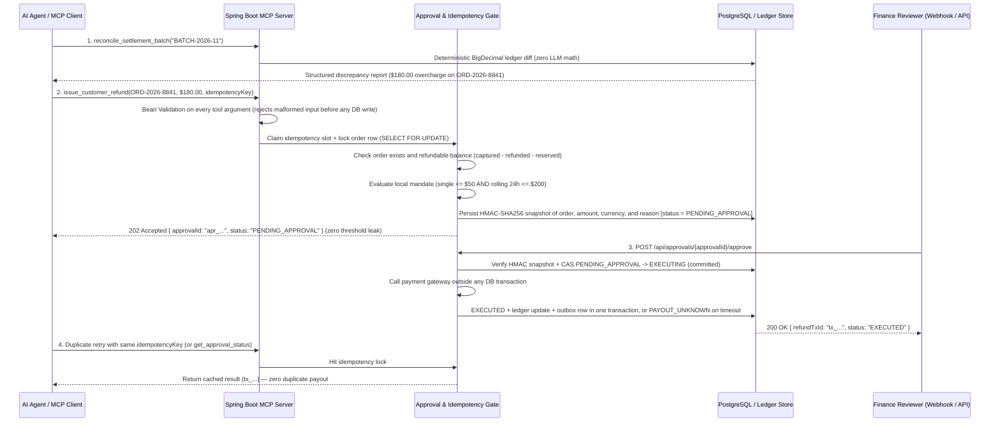

# spring-mcp-settlement-guard

[-brightgreen)](#deterministic-ci-testing-zero-api-burn)
[](#quick-start-3-minutes)
[](https://docs.spring.io/spring-ai/reference/api/mcp/mcp-server-boot-starter-docs.html)
[](#license)

**Production-grade reference architecture for exposing financial & state-mutating Spring Boot APIs to AI Agents over MCP—with deterministic reconciliation, local-first hidden mandates, anti-smurfing velocity locks, idempotency gates, and two-phase human-in-the-loop approval.**

Most AI agent prototypes look great in a notebook and fail the moment they touch real money or production databases:
1. **Tool retries trigger duplicate payouts or double writes.**
2. **LLMs hallucinate on arithmetic** that should stay in deterministic `BigDecimal` code.
3. **Adversarial or prompt-injected agents split claims ("smurfing") or probe remote mandates** to drain accounts just under per-call limits.
4. **High-impact mutations execute without a pause/resume human approval boundary.**
5. **CI pipelines either skip agent tests or burn API credits on flaky LLM calls.**

This repository demonstrates a clean, battle-tested pattern derived from high-concurrency clearing & settlement systems: **keep deterministic math and hidden mandates inside your local Java backend, serialize per-order velocity checks under row locks, and gate high-risk writes behind an HMAC-SHA256 approval checkpoint.**

## How the Two-Phase Guardrail Works



## Core Engineering Guarantees

| Failure Mode in Naive Agents | How `spring-mcp-settlement-guard` Solves It |
| :--- | :--- |
| **Duplicate mutations on timeout/retry** | Stripe-style 3-state `IdempotencyKeyStore` (`IN_PROGRESS` / `COMPLETED` / `UNKNOWN_SUSPENDED`) backed by a DB unique constraint in an isolated transaction before side effects run. The fingerprint covers every business field, so reusing a key with any changed field is a `409`. If an agent retries under a *new* key while an identical refund (same order, amount, currency, reason) is still pending, executing, or frozen, the request is linked to the existing one instead of reserving and paying again. Once money has moved, the caller always gets the settled result, even if storing the receipt fails. |
| **Gateway timeout after money may have moved** | The payout is reserved as `EXECUTING` and committed *before* the gateway call, which runs outside any DB transaction. A timeout freezes the request as `PAYOUT_UNKNOWN`: it keeps counting against limits and cannot be approved again. Finance closes it with `POST /api/approvals/{id}/confirm-payout` (money moved; ledger is updated with the gateway transaction id) or `POST /api/approvals/{id}/release-payout` (money did not move; the reservation is released). A provider transaction id can settle only one refund. |
| **Refunds for unknown orders or over-refunds** | Under the order row lock, the request is rejected unless the order exists and `amount <= captured - already refunded - reserved (pending / executing / unknown)`. |
| **Split-claim ("smurfing") & race attacks** | `ApprovalGateService` acquires a `SELECT ... FOR UPDATE` per-order lock and sums `EXECUTED`, `EXECUTING`, `PAYOUT_UNKNOWN` and in-flight `PENDING_APPROVAL` amounts across a rolling 24h window (`<= $200.00` default). |
| **Malformed or injected tool arguments** | Every MCP tool parameter carries Bean Validation constraints (`@Digits`, `@Pattern`, `@Size`); invalid input is rejected before an idempotency slot is claimed or a row lock is taken. |
| **Mandate probing & prompt injection** | Mandates remain 100% local in Spring configuration; MCP tools return opaque hold messages without leaking internal thresholds, remaining allowances, or reviewer identities. |
| **Payload swapping before sign-off** | Paused actions store an HMAC-SHA256 of order id, amount, currency, and reason, keyed by a server secret. `/api/approvals/{id}/approve` accepts zero amount inputs, re-verifies the MAC, and claims execution via atomic CAS. Rewriting the amount and the stored digest together still fails. |
| **Conflicting reviewer decisions** | Approve and reject are both CAS transitions from `PENDING_APPROVAL`. The loser gets a `409`, so a rejection webhook is never sent for a refund that was actually paid. |
| **Unauthorized self-approval** | Roles are derived server-side from which secret matched: `X-MCP-API-Key` grants only `ROLE_MCP_AGENT`, `X-Reviewer-Key` grants only `ROLE_FINANCE_APPROVER`. Callers cannot assert a role. |
| **Crashes mid-flight** | `StaleExecutionSweeper` freezes idempotency keys stuck in `IN_PROGRESS` and payouts stuck in `EXECUTING` (default 15 min). The approval outbox row is inserted in the same transaction as the status change, and the sweeper redelivers anything still unpublished. |
| **Schema drift** | Flyway owns the schema (`db/migration`); Hibernate runs with `ddl-auto: validate`. |
| **LLM arithmetic errors** | Ledger matching and currency rounding run strictly in read-only Java `BigDecimal` domain services (`DeterministicReconciler`). |
| **Expensive, flaky CI tests** | Full integration suite uses the official `McpSyncClient` over SSE + multi-threaded race harnesses. JDK 17 and 21 run on H2; a separate job runs the same suite on PostgreSQL 16. No external LLM API keys. |

## Project Layout

```text
spring-mcp-settlement-guard/
├── docker-compose.yml
├── pom.xml
└── src/
    ├── main/java/io/mcpguard/settlement/
    │   ├── McpSettlementGuardApplication.java
    │   ├── config/
    │   │   ├── DemoDataInitializer.java
    │   │   ├── GuardrailConfigurationGuard.java
    │   │   ├── GuardrailProperties.java
    │   │   └── McpSecurityConfig.java
    │   ├── domain/
    │   │   ├── DeterministicPaymentGateway.java
    │   │   ├── DeterministicReconciler.java
    │   │   ├── OrderAnchorLockService.java
    │   │   ├── OrderSettlementAnchor.java
    │   │   ├── PaymentGatewayPort.java
    │   │   ├── SettlementInvoiceItem.java
    │   │   └── SnapshotHasher.java
    │   ├── guardrail/
    │   │   ├── ApprovalEventOutbox.java
    │   │   ├── ApprovalGateService.java
    │   │   ├── ApprovalRestController.java
    │   │   ├── ApprovalStatus.java
    │   │   ├── ApprovalWebhookNotifier.java
    │   │   ├── DemoRefundController.java
    │   │   ├── IdempotencyKeyStore.java
    │   │   ├── RefundApprovalOrder.java
    │   │   └── StaleExecutionSweeper.java
    │   ├── mcp/
    │   │   ├── McpServerToolsConfig.java
    │   │   ├── ReconciliationMcpTools.java
    │   │   └── RefundActionMcpTools.java
    │   └── telemetry/
    │       └── ToolExecutionAuditLog.java
    ├── main/resources/db/migration/
    │   ├── V1__baseline_schema.sql
    │   ├── V2__payout_release_and_ledger_guards.sql
    │   └── V3__unique_transaction_id.sql
    └── test/java/io/mcpguard/settlement/
        ├── ApprovalLifecycleIT.java
        ├── GuardrailEdgeCaseIT.java
        ├── DemoEndpointDisabledIT.java
        ├── DeterministicMockAgentTest.java
        └── config/GuardrailConfigurationGuardTest.java
```

## Quick Start (3 Minutes)

Prerequisites: JDK 17+ (or JDK 21). The default run uses embedded H2, seeds four sample invoices, and exposes the demo refund endpoint. The `postgres` profile talks to PostgreSQL 16, turns both of those demo switches off, and refuses to start on the published demo keys.

```bash
# Default demo on H2 (SSE at http://localhost:8080/sse)
./mvnw spring-boot:run

# PostgreSQL 16. Demo seed and /api/demo are disabled; bring your own keys.
docker compose up -d
MCP_AGENT_API_KEY=replace-me \
MCP_REVIEWER_API_KEY=replace-me \
MCP_SNAPSHOT_HMAC_KEY=replace-me \
  ./mvnw spring-boot:run -Dspring-boot.run.profiles=postgres
```

Try the two-phase approval flow locally:

```bash
# 1. Trigger a high-value refund (> $50.00 single auto-approval mandate)
curl -X POST http://localhost:8080/api/demo/simulate-agent-refund \
  -H "Content-Type: application/json" \
  -H "X-MCP-API-Key: mcp-demo-agent-key-2026" \
  -d '{"orderId": "ORD-2026-8841", "amount": "180.00", "currency": "USD", "reasonCode": "DUPLICATE_CHARGE", "idempotencyKey": "idem-8841-01"}'

# Response (202 Accepted):
# {"status":"PENDING_APPROVAL","approvalId":"apr_...","refundTxId":null,"orderId":"ORD-2026-8841","amount":180.00,"currency":"USD","message":"Paused for human sign-off"}

# 2. Approve the paused action as a finance reviewer (atomic CAS + HMAC-SHA256 snapshot verification)
curl -X POST http://localhost:8080/api/approvals/apr_.../approve \
  -H "X-Reviewer-Key: mcp-demo-reviewer-key-2026" \
  -H "X-Reviewer-Id: finance-lead@company.com"
```

## Deterministic CI Testing (Zero API Burn)

Every guardrail, anti-smurfing velocity cap, concurrent race lock, and MCP SSE handshake is verified offline without calling external LLM providers:

```bash
./mvnw clean verify
```

JDK 17 and 21 run that command on H2. CI also runs it once against PostgreSQL 16 so Flyway V1/V2 and `SELECT ... FOR UPDATE` are exercised on the database the row locks are written for.

Key verified scenarios in `ApprovalLifecycleIT`, `GuardrailEdgeCaseIT` & `DeterministicMockAgentTest`:
- Real MCP SSE wire handshake (`initialize` -> `listTools` -> `callTool`) via the official `McpSyncClient`.
- Malformed tool arguments (`45.005`, `forty five`, `-10.00`, `US Dollars`, SQL fragments) are rejected over the wire with no idempotency row and no payout.
- Auto-executes low-risk refunds at or below `$50.00` and logs zero-token audit telemetry.
- Pauses refunds above `$50.00` into `PENDING_APPROVAL` without touching downstream payment adapters.
- Rejects refunds for unknown orders or beyond the remaining refundable balance, and releases the idempotency key so the agent can correct the request.
- Blocks split-claim smurfing attacks exceeding `$200.00` across a rolling 24-hour window (counting in-flight pending approvals) without leaking mandate thresholds.
- Guarantees strict velocity caps and at-most-once execution under 10-thread concurrent refund and concurrent approval races.
- Freezes a payout as `PAYOUT_UNKNOWN` when the gateway times out, on both the auto and the human-approved path, and blocks every retry route.
- Never reports a rejection when a concurrent approval won, or after the request expired.
- Rejects tampered idempotency payloads (`409`), tampered DB snapshots (`422`), expired approvals, and unauthorized self-approval attempts (`401` / `403`).
- Freezes requests left in flight by a crash via the stale-execution sweeper.
- Ten concurrent callers on one idempotency key produce exactly one payout.
- An agent that switches to a new key while the same refund is pending approval or mid-payout is linked to the existing request; the new key later replays the settled result.
- Partial failures after money moved (audit write, receipt write, ledger update) never surface a payout as failed and never pay twice. Failures are injected with temporary CHECK constraints, so production code runs unmodified.
- One provider transaction id cannot settle two frozen payouts; concurrent confirm and release on the same payout leave exactly one consistent outcome.
- Unknown order ids leave no rows behind; a key frozen by a crash before any reservation is recovered on retry.
- Startup refuses blank keys and the published demo keys outside demo mode; the demo endpoint returns `404` when disabled.

## Production Notes

- **Credentials:** the H2 demo uses one shared agent key and one shared reviewer key, and takes the reviewer identity from `X-Reviewer-Id`. Blank keys are rejected at startup. The `postgres` profile also rejects the published demo keys. In production, replace both secrets with OAuth2 / JWT and read the reviewer from the token subject.
- **`PAYOUT_UNKNOWN`:** the request stays reserved and cannot be approved again. After checking the gateway, finance either confirms settlement or releases the hold:

```bash
# Money moved. Body is the provider transaction id; the amount stays the signed snapshot.
curl -X POST http://localhost:8080/api/approvals/apr_.../confirm-payout \
  -H "Content-Type: application/json" \
  -H "X-Reviewer-Key: mcp-demo-reviewer-key-2026" \
  -H "X-Reviewer-Id: finance-lead@company.com" \
  -d '{"transactionId":"tx_provider_123"}'

# Money did not move. The reservation is released and a corrected refund can be submitted.
curl -X POST http://localhost:8080/api/approvals/apr_.../release-payout \
  -H "X-Reviewer-Key: mcp-demo-reviewer-key-2026" \
  -H "X-Reviewer-Id: finance-lead@company.com"
```

  The decision row is inserted into `approval_event_outbox` in the same transaction as that status change. Delivery happens after commit; a crash before delivery is retried by `StaleExecutionSweeper`.
- **Payment adapter:** `DeterministicPaymentGateway` is a sandbox. A real adapter should forward the idempotency key to the provider (Stripe, Adyen, etc.) so the provider also deduplicates.

## Adapting This to Your Stack (Commercial Support)

Need to wire AI agents or MCP servers into your existing **Spring Boot, Java, or Python** production backend without risking duplicate writes, compliance gaps, or runaway token bills?

I help US/EU engineering teams ship production-safe agent workflows on **predictable fixed-price milestones** (async-first workflow with written specs, sequence diagrams, and recorded walkthroughs):

- **Architecture Audit & Sandboxed Pilot ($600 / 5 business days):** 1-page architecture spec + 2 read-only/sandboxed MCP tools over your APIs + offline CI test harness.
- **Production Two-Phase Approval Integration ($2,000–$3,500 / 2 weeks):** End-to-end MCP/LangGraph workflow, human-in-the-loop approval state machine, role-based security, and per-run token telemetry.

Reach out with a brief note on your stack: **fyang1989127@gmail.com**

## License

MIT
